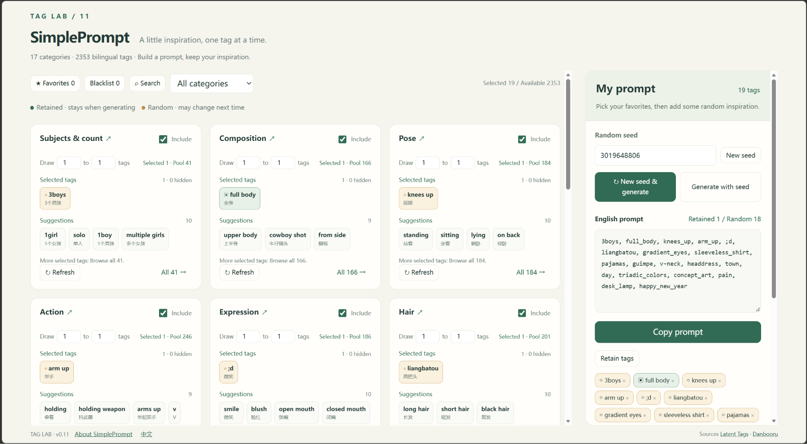
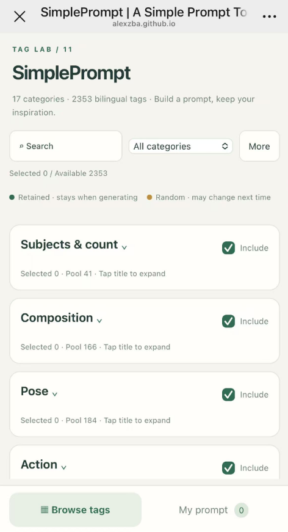

# SimplePrompt

**English** | [简体中文](./README.zh-CN.md)

**A Simple Prompt Tool for Beginners**

A beginner-friendly AI image prompt builder with a clean, intuitive UI.
Explore bilingual tags, mix and match ideas, and generate prompts with ease.

Works on desktop and mobile, with Chinese and English tag search, favorites, a blacklist, and random generation that keeps your selected tags.

[Open SimplePrompt](https://alexzba.github.io/SimplePrompt/)

## Screenshots

### Desktop

### Mobile

## Usage

Use the [online version](https://alexzba.github.io/SimplePrompt/), or open `index.html` directly in your browser. No dependencies need to be installed.

Favorites, blacklist entries, tag combinations, and settings are saved in your own browser. They are not uploaded to the repository or a server.

## Interface language

The first visit follows the browser's preferred system language. Chinese (`zh-*`) uses the Chinese UI; English and other languages use English.

Switch with **English / 中文** next to **About SimplePrompt**. On phones, both are in **More**. Your manual preference is remembered in this browser. Switching languages does not change your tag combinations, favorites, blacklist, or random seed.

Both interfaces support Chinese and English searches. Copied prompts still use English tags.

## License

Copyright © 2026 AlexZBA. The software code is licensed under the [MIT License](./LICENSE).

Commercial use, modification and redistribution are permitted. Keep the copyright and permission notice with copies or substantial portions of the software. Publishing modified source code or displaying credit in the user interface is not required. See [LICENSE](./LICENSE) for the full terms.

## Development acknowledgement

This project was developed with programming assistance from ChatGPT.

## Data sources

Tag data comes from the Danbooru snapshot used by [Latent Tags](https://tags.latent.moe/en). Categories and some Chinese definitions have been curated.

Third-party tags, translations, and other third-party content are not relicensed under this project's code license. Their respective rights and licenses still apply.

Original project: [AlexZBA/SimplePrompt](https://github.com/AlexZBA/SimplePrompt).
