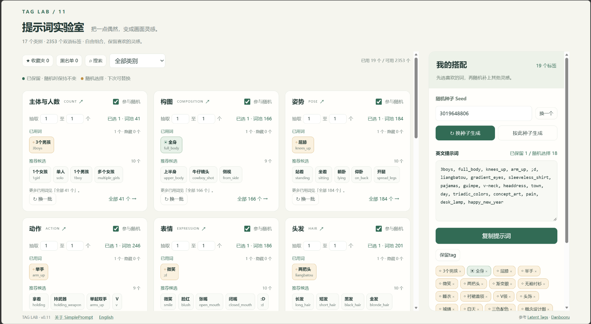
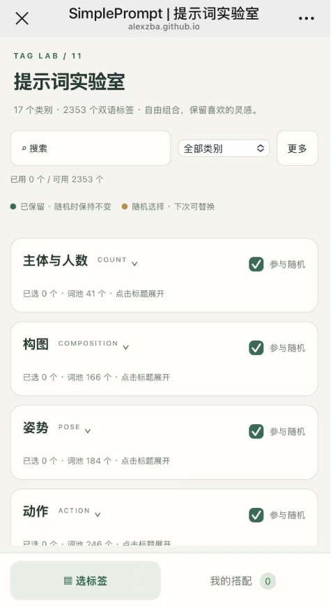

# SimplePrompt

[English](./README.md) | **简体中文**

**面向 AI 生图新手的提示词工具**

提供干净易用的界面，支持手机和桌面、中英标签搜索、自由搭配、收藏、黑名单，以及保留已选词的种子随机生成。

[在线使用 SimplePrompt](https://alexzba.github.io/SimplePrompt/)

## 界面预览

### 桌面端

### 手机端

## 使用

可以直接访问[在线版本](https://alexzba.github.io/SimplePrompt/)，也可以用浏览器打开 `index.html`，无需安装依赖。

收藏、黑名单、搭配与设置保存在使用者自己的浏览器，不会上传到仓库或服务器。

## 界面语言

首次打开按浏览器提供的首选语言显示界面。中文（`zh-*`）使用中文界面，英语及其他语言使用英文界面。

可在“关于 SimplePrompt”旁通过 **English / 中文** 切换，手机端入口位于“更多”菜单。手动选择会保存在当前浏览器；切换不会改变搭配、收藏、黑名单或随机种子。

两种界面均支持中英搜索，复制结果仍为英文 tag。

## 许可证

Copyright © 2026 AlexZBA.

本项目的软件代码采用标准 [MIT 许可证](./LICENSE)，允许商用、修改和分发，不强制公开修改后的源码。复制或分发代码及其实质性部分时，须保留版权和许可声明；不强制在主页或“关于”界面展示署名。完整条款以 [LICENSE](./LICENSE) 为准。

## 开发说明

本项目使用 ChatGPT 辅助编程。

## 数据来源

标签数据来自 [Latent Tags](https://tags.latent.moe/en) 使用的 Danbooru 快照，分类和部分中文释义经过整理。

第三方标签、译文及其他第三方内容不因本项目的代码许可证而被重新授权，相关权利与许可仍单独适用。

原项目：[AlexZBA/SimplePrompt](https://github.com/AlexZBA/SimplePrompt)。
